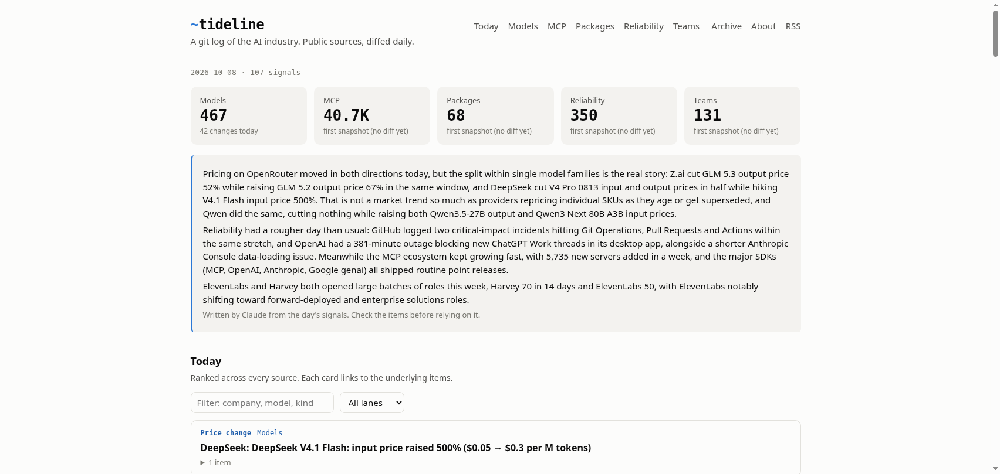

# ~tideline

**A git log of the AI industry.** Tideline snapshots public sources that describe the AI industry every
day, diffs today against yesterday, ranks what changed, and publishes it as a static site and an RSS feed.
The repository is the database: every change in the industry is a line in a commit.

**Site:** https://harshanchenna.github.io/tideline · **Feed:** [RSS](https://harshanchenna.github.io/tideline/feed.xml)



| Lane | Source | What it surfaces |
|---|---|---|
| **Models** | OpenRouter's public model catalog | New models, delistings, price and context-window changes |
| **MCP** | The official Model Context Protocol registry | New servers, launches from domain-verified publishers, releases, retirements |
| **Packages** | PyPI and npm, plus their public download stats | Releases of the SDKs, frameworks and engines AI is built on; download momentum |
| **Reliability** | Providers' public status pages | Incidents, how long they lasted, each provider's week |
| **Teams** | AI companies' public job boards (Greenhouse, Lever, Ashby) | What companies are staffing up for: new teams, theme pushes, leadership roles. Aggregates only |

## How it works

```
fetch ──> snapshots/<lane>.jsonl ──diff vs last commit before today──> events/YYYY/MM/DD.jsonl
                                                                          │
                                         lane.signals(diff) ──> digests/YYYY/MM/DD.json ──> site/
```

- **Snapshots** are sorted JSON lines, one entity per line, so `git diff` and `git log -p` read naturally.
- **Events** are what changed: `added`, `removed`, or `changed` with the field, old and new values.
- **Digests** hold the day's ranked signals, lane health and the optional brief. The site is built only
  from digests, events and snapshots, so any past day can be re-rendered without refetching.

Guards, because a diff is only as honest as its inputs:

- A lane's **first run** records a baseline and emits no events, so day one isn't "40,000 things appeared".
- A lane that **fails**, or returns **under half** of yesterday's entities, keeps its previous snapshot:
  an outage never reads as mass removals.
- "Yesterday" is the snapshot in the last commit before today (UTC), so a same-day rerun recomputes
  the same diff instead of diffing against itself.
- The MCP registry (40k+ servers) is read incrementally via `updated_since`, with a full re-read on Sundays.

The optional **brief** is written by headless Claude Code with no tools, no MCP servers and an empty
working directory, from the day's top signals only. Its output is HTML-escaped. Third-party text
(model names, server descriptions, incident titles) is treated as data everywhere: escaped on render,
and only `http(s)` links reach an `href`.

## Run it

Standard library only, Python 3.11+.

```bash
python -m tideline run                 # every lane, then render site/
python -m tideline run --lanes models  # just one lane
python -m tideline run --brief         # also write the brief (needs `claude` on PATH)
python -m tideline site                # re-render site/ from what's on disk
python -m unittest discover -s tests -t .
```

In this repository, `.github/workflows/daily.yml` does the daily pass on a schedule, commits the data,
and deploys the site to GitHub Pages. It stores no tokens; the brief runs only if an `ANTHROPIC_API_KEY`
secret is set.

## Add a lane

A lane is one module in `tideline/lanes/` exporting `LANE = Lane(...)`:

- `fetch() -> list[dict]`: today's entities, each with a unique `id`. Raise on failure.
- `signals(result) -> list[dict]`: read `result.events` (or `result.today` on a bootstrap run) and
  return scored signals built with `lanes.common.sig`.
- `label` and `url`: how an entity is named and linked in the change log (`url` defaults to the entity's `url` field).
- `volatile`: fields stored but not diffed (counters, timestamps).
- `track_removed=False` for sources that are rolling windows.

Register it in `tideline/lanes/__init__.py` and add its source to the About page.

## Data and caveats

All sources are public and unauthenticated. The Teams lane stores no individual posting, pay range or
link, only company-level counts and notes; job postings are evidence of direction, not proof. Download
counts are what the registries report, bots included. Nothing here is investment advice.

MIT licensed.
